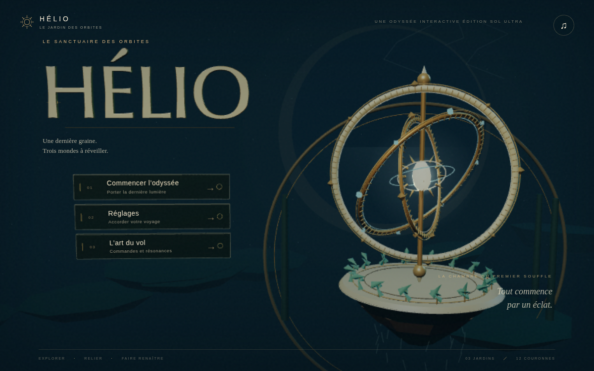
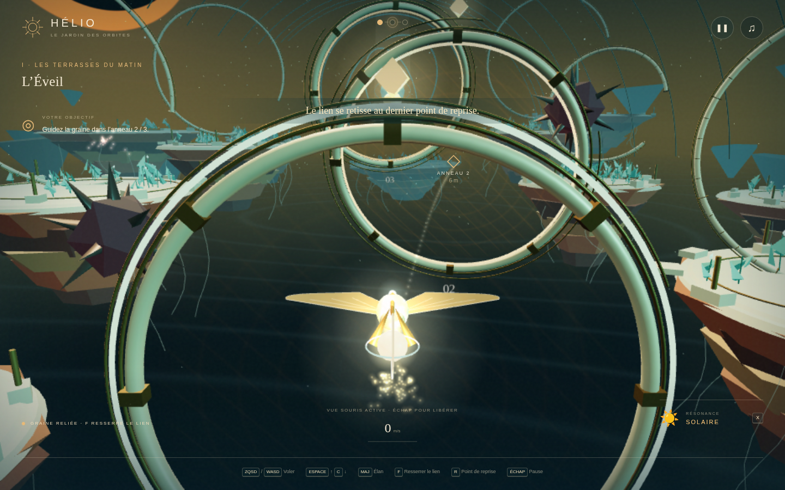
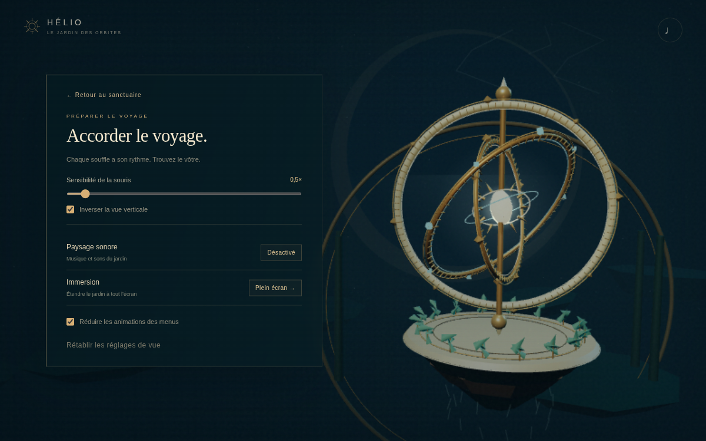
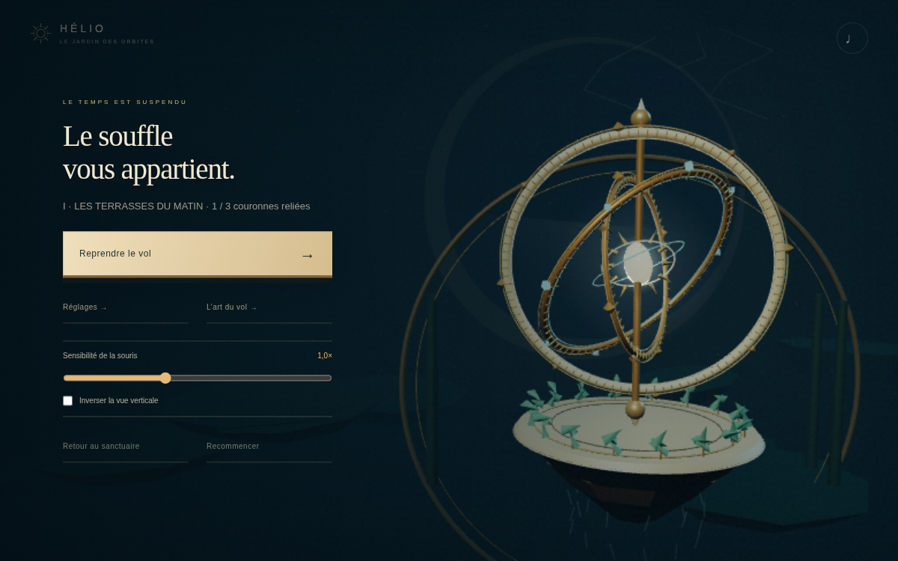
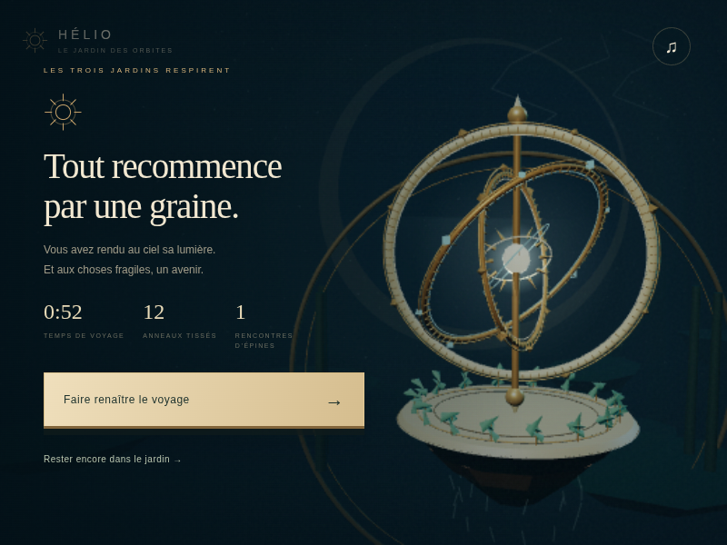

# HÉLIO — Le jardin des orbites

**Un voyage de vol et de résonance dans trois jardins célestes.**

[**Jouer dans le navigateur →**](https://helio-jardin-des-orbites.martzloffeyden.chatgpt.site/?v=1.1.0) · [Lancer le projet](#jouer) · [Commandes](#commandes) · [Tests et validation](VALIDATION.md)



Une aventure originale de vol en trois dimensions. Pilotez un insecte solaire, recueillez une graine de lumière et guidez-la à travers trois jardins suspendus pour réveiller le soleil.

**3 jardins · 12 couronnes · 2 résonances · Musique procédurale · Sauvegarde locale**

## Captures du jeu

| Vol et lien avec la graine | Réglages du voyage |
| --- | --- |
|  |  |
| **Pause et reprise du vol** | **Victoire et rejeu** |
|  |  |

Ces captures proviennent du jeu exécuté dans Chromium pendant les vérifications automatisées. Elles sont conservées dans [`docs/images/`](docs/images/).

## Jouer

[Ouvrir la version jouable en ligne](https://helio-jardin-des-orbites.martzloffeyden.chatgpt.site/?v=1.1.0).

Pour lancer le projet sur votre machine : **Node.js 18 ou ultérieur**, puis, depuis ce dossier :

```sh
git clone https://github.com/martzloffeyden-hub/SOL-ULTRA-3D-GAME.git
cd SOL-ULTRA-3D-GAME
npm start
```

Ouvrir **http://localhost:4173**. Aucune installation npm ni compilation nécessaire. Autre possibilité : `python3 -m http.server 4173 --directory dist`.

Le jeu cible un ordinateur avec clavier, souris et navigateur récent compatible WebGL 2. Tous les graphismes, sons et dépendances sont inclus ou produits localement ; aucune connexion n’est nécessaire une fois le projet servi.

## Le sanctuaire en trois dimensions

L’accueil, la pause, les réglages, le guide et les écrans de progression partagent un observatoire en 3D : titre extrudé, astrolabe animé et plaques de navigation physiques. Les libellés accessibles suivent exactement leur projection dans la scène. Les boutons fonctionnent aussi au clavier.

La pause permet de retourner au sanctuaire sans perdre le vol en cours, puis de le reprendre. Les réglages regroupent vue, son, plein écran et réduction des animations des menus.

## Commandes

| Commande | Action |
| --- | --- |
| ZQSD / WASD | Vol horizontal, relatif à la caméra |
| Espace / C | Monter / descendre |
| Clic dans le jeu puis déplacer la souris | Regarder librement sur deux axes |
| Maintenir un clic et glisser | Solution de repli si la capture est indisponible |
| Flèches gauche / droite | Tourner sans souris |
| Maj | Accélérer |
| F maintenu | Resserrer le lien, ralentir et guider plus précisément |
| X | Alterner entre résonance solaire et lunaire |
| E | Recueillir la graine / réveiller un jardin à proximité |
| R | Revenir au dernier point de reprise |
| Échap | Libérer la souris et mettre en pause |
| Bouton ♫ | Couper ou activer le son |

La pause permet de régler la sensibilité de la souris et d’inverser la vue verticale. Le bouton **Reprendre le vol** recapture la souris.

## Le voyage

Approchez la graine et appuyez sur **E**. Elle vous suit grâce à un lien souple. C’est **la graine** qui doit traverser les anneaux dans l’ordre, dans le sens indiqué par le chemin lumineux. L’anneau actif est signalé par un repère et une distance. Continuez un peu après l’anneau pour laisser passer la graine.

Les couronnes ambre demandent une résonance **solaire** ; les couronnes azur demandent une résonance **lunaire**. Appuyez sur **X** pour vous accorder. Une mauvaise résonance vous repousse. Les épines repoussent également, sans supprimer les anneaux déjà validés.

Après tous les anneaux d’un jardin, apportez la graine à son cœur et appuyez sur **E**. Les trois jardins proposent douze anneaux au total, des virages, des changements d’altitude et une alternance de résonances. Après la victoire, rejouez ou continuez à voler librement.

La progression est sauvegardée **au début de chaque jardin** dans le stockage local du navigateur. La pause conserve la progression actuelle. La victoire et le rejeu réinitialisent le voyage.

## Architecture

- `dist/game.js` : simulation, commandes, caméra, graine, collisions, interface et progression.
- `dist/menu-scene.js` : observatoire, titre et plaques de navigation en 3D.
- `dist/menu-ui.css` : interfaces du sanctuaire, de la pause et des écrans de progression.
- `dist/world.js` : archipel, architecture, végétation, ciel et lever du soleil final.
- `dist/mouse-look.js` : capture de la souris, regard libre et glisser de repli.
- `dist/audio.js` : musique et effets synthétisés avec Web Audio, démarrés après une interaction.
- `dist/levels.js` : parcours et obstacles des trois jardins.
- `dist/physics.js` : intersection continue des anneaux et contacts sphériques.
- `dist/vendor/three.module.js` : Three.js r170, inclus avec sa licence MIT.
- `server.mjs` : serveur statique sans dépendances.
- `tests/` : géométrie et parcours navigateur reproductibles.

La scène partage ses géométries et utilise des instances pour le décor. Le rendu ajuste sa résolution quand le débit d’images baisse et choisit une résolution initiale réduite sur les moteurs logiciels détectés. Les effets lumineux reposent sur des sprites et des matériaux émissifs.

## Vérification

```sh
npm test
```

Tests de géométrie avec le lanceur intégré de Node.js. Pour les tests navigateur, installer Playwright pour Python et Chromium, lancer le jeu, puis :

```sh
python tests/browser.py
python tests/camera.py
python tests/menus.py
python tests/journey.py
```

Le script utilise Chromium installé dans `/usr/bin/chromium` (adapter ce chemin si nécessaire). Les tests navigateur utilisent `?qa=1`, uniquement sur `localhost` ou `127.0.0.1`. Ce mode permet de placer le joueur à l’approche des obstacles et d’avancer la simulation normale. Il ne permet pas de modifier les compteurs de progression. Le test accéléré ne constitue pas une partie manuelle intégrale.

Les rapports réels et les limites de mesure sont détaillés dans [VALIDATION.md](VALIDATION.md) :

- [Géométrie et monde](tests/) : 12 tests réussis.
- [Jeu dans le navigateur](test-output/browser-report.json) : 34 vérifications réussies.
- [Caméra et souris](test-output/camera-report.json) : 17 vérifications réussies.
- [Menus 3D](test-output/menus-report.json) : 22 vérifications réussies.
- [Parcours continu jusqu’à la victoire et au rejeu](test-output/journey-report.json) : 21 contrôles réussis.

## Crédits

Conception, programmation, graphismes et musique procédurale créés pour le défi SOL ULTRA. Moteur : Three.js, © 2010–2024 Three.js authors, licence MIT dans `dist/vendor/THREE-LICENSE.txt`. Aucun asset distant, police web ou compte tiers requis pour jouer localement.

Titre 3D : police Optimer, © MAGENTA Ltd., 2004, distribuée avec sa licence dans `dist/vendor/OPTIMER-LICENSE.txt` et dans le fichier de police JSON.
